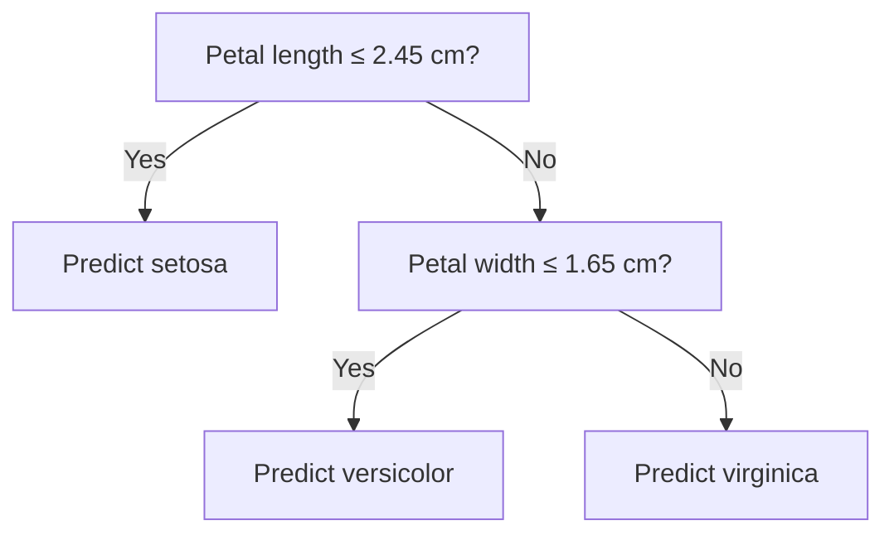

# Decision Trees

> [!summary] The central idea
> A decision tree learns a sequence of questions that divides labeled examples into more consistent groups. A new example follows one path, and its leaf supplies the predicted category.

## Begin with an observable decision
Ask: **“Could we suggest a flower's species by asking a few questions about its measurements?”**
Examples of possible questions are “Is the petal shorter than a chosen length?” and “Is its width at most a chosen value?” A person can write rules manually. A learning algorithm searches labeled examples for useful rules and thresholds.

Introduce only the vocabulary needed here:

| Term                | Meaning in this lesson                                                |
| ------------------- | --------------------------------------------------------------------- |
| Example or row      | One measured flower sample                                            |
| Feature             | A measurement available as input                                      |
| Label or target     | The known species for an observed flower                              |
| Classification      | Predicting a category                                                 |
| Training or fitting | Learning questions from labeled examples                              |
| Prediction          | Applying the learned questions without seeing the new example's label |

The labels `0`, `1`, and `2` stand for species names. They do not say that one species is twice another.

## A real dataset and a concrete use
We use the historical **Iris** measurements associated with Fisher's study. The data have 150 observations, three species, and four measured features. Our models use **petal length** and **petal width**, both in centimeters, to keep the questions and decision regions visible in two dimensions. All observations are retained across the three data partitions.

The notebook loads scikit-learn's bundled copy. It incorporates corrections to two records described in the loader documentation; it is not byte-for-byte the older UCI file. This is measured source data, not a generated classroom dataset. The HTML embeds the same measurements, row assignments, and fitted models.

The motivating application is a plant-recording assistant that suggests one of three known species and provides a path a user can inspect. This establishes practical relevance without claiming that a small historical dataset validates a field identification product.

> [!question] Ask before showing a model
> Looking only at the training scatterplot, where might a question separate one species from the others? Would that one question identify all three species?

## Learn the parts of a tree
- **Root:** the first node, containing all fitting examples.
- **Internal node:** a question such as petal length ≤ 2.45 cm.
- **Branch:** the route determined by the answer.
- **Leaf:** a terminal group with a predicted label.
- **Depth:** number of edges from the root; the root has depth zero.

In this implementation, “yes, value ≤ threshold” goes left and “no, value > threshold” goes right. A prediction visits one path, not all leaves.

The following is the actual depth-two demonstration tree fitted on the notebook's 90 training flowers. Threshold labels are rounded; computation uses stored values.

Each leaf predicts the label with the largest fitting count. In a problem with three or more categories, that need not be more than half the examples. If largest counts tie, scikit-learn chooses the tied class with the lowest encoded index.

## How do we decide whether a question is useful
A good immediate question sends examples into children whose labels are less mixed overall. We need a consistent way to measure that mixture.

### Gini impurity
Let $p_k$ be the fraction of a node's fitting examples with label $k$. Then:
$$
G = 1 - \sum_{k=1}^{K}p_k^2
$$
Interpret the calculation before memorizing it. Squaring and summing the label fractions gives a high result when most examples belong to one label. Subtracting from one makes a pure node have impurity zero.

| Label counts | Fractions       | Gini            |
| ------------ | --------------- | --------------- |
| [3, 0, 0]    | [1, 0, 0]       | $1-1^2=0$       |
| [2, 2, 0]    | [1/2, 1/2, 0]   | $1-1/4-1/4=1/2$ |
| [1, 1, 1]    | [1/3, 1/3, 1/3] | $1-3(1/9)=2/3$  |

For three classes, the largest possible impurity is $2/3$. Do not teach “Gini always ranges from 0 to 0.5”; that upper limit applies to two classes. Gini is not a percentage of wrong predictions.

### Weight the two children
If the parent contains $n$ examples, and its children contain $n_L$ and $n_R$:
$$
G_{after}=\frac{n_L}{n}G_L+\frac{n_R}{n}G_R
$$
$$
\Delta G=G_{parent}-G_{after}
$$

Prefer the legal split with the lowest weighted child impurity. At a fixed parent, that is the same as the largest impurity reduction. Use “Gini reduction” here so students do not confuse this with entropy-based information gain.

The weights matter. A child containing most of the examples must count more than a child containing only a few. Never average child impurities equally unless the child sizes are equal.

## Calculate a split using the original observations
The notebook reserves 90 training flowers, containing 30 of each species. In class order setosa, versicolor, virginica, the root counts are **[30, 30, 30]**.

Try **petal length ≤ 2.45 cm**:

| Node | Count | Label counts | Gini |
|---|---|---|---|
| Parent | 90 | [30, 30, 30] | $2/3$ |
| Left child | 30 | [30, 0, 0] | $0$ |
| Right child | 60 | [0, 30, 30] | $1/2$ |

Calculate:
$$
G_{after}=\frac{30}{90}(0)+\frac{60}{90}\left(\frac12\right)=\frac13
$$
$$
\Delta G=\frac23-\frac13=\frac13
$$

If we had averaged the two child impurities equally, we would obtain $1/4$, which is wrong for these unequal child sizes.

> [!question] Pause for calculation
> A split makes one small child pure. Is it automatically a good split? Explain what else you need to inspect.

Expected answer: inspect both children, their sizes, and their impurities. A large mixed sibling can outweigh the benefit of a small pure child.

## How the algorithm learns the complete tree
For the numeric features in this lesson:
1. Consider only fitting examples that have reached the current node.
2. For each feature, sort its distinct observed values.
3. Try thresholds between neighboring distinct values.
4. Reject splits that violate required child sizes.
5. Choose a legal question with the greatest immediate impurity reduction.
6. Route examples into the two children and repeat where growth is allowed.
7. At a leaf, retain label counts and predict the largest group.

Equal feature values stay on the same side of a numeric threshold. No split is allowed to have an empty child. Several questions may have the same score; a seeded library implementation can select one of those tied questions. Matching the best score matters more than forcing an arbitrary tie to resolve identically.

> [!Important]
> This strategy is **greedy**: it optimizes the next step. It does not compare every complete possible tree, so the root question is not a guarantee of a globally optimal final tree.

The right child of our demonstration root contains [0,30,30]. It next asks petal width ≤ 1.65 cm, producing leaves [0,30,1] and [0,0,29]. Only examples reaching that child determine that question.

### What is learned and what is chosen

| Learned during fitting             | Chosen before fitting              |
| ---------------------------------- | ---------------------------------- |
| Feature used at each internal node | Candidate input features           |
| Numeric threshold at each question | Impurity criterion                 |
| Leaf label counts                  | Maximum allowed depth              |
| Largest label group at a leaf      | Minimum allowed examples in a leaf |

`max_depth=2` permits at most two questions along a root-to-leaf path. It does not require every path to ask exactly two questions. `min_samples_leaf` stops questions that leave too few fitting examples in either proposed child.

A node may stop because it is pure, because the depth cap is reached, or because no valid split meets the growth constraints. “Keep splitting until every leaf is pure” is not a safe general training policy.

## Follow one flower from root to leaf
Take a hypothetical input: length **4.8 cm**, width **1.6 cm**. These values are a user-entered example, not an additional source record.
1. Is 4.8 ≤ 2.45? No: go right.
2. Is 1.6 ≤ 1.65? Yes: go left.
3. The leaf contains [0,30,1]. Predict **versicolor**.

The label fractions in that leaf are $0/31$, $30/31$, and $1/31$. The largest fraction determines the prediction. These fractions summarize fitting examples; they are not a guarantee that a new prediction is correct. A leaf with only one fitting example can look perfectly pure and still generalize poorly.

## Evaluate whether the learned rules generalize
Use three distinct sets:

| Set        | Rows | Purpose                                      |
| ---------- | ---- | -------------------------------------------- |
| Training   | 90   | Learn questions and thresholds               |
| Validation | 30   | Choose among the declared depth settings     |
| Test       | 30   | Final audit after the depth choice is frozen |

Each partition is stratified by species. Validation and test examples do not participate in fitting the demonstration trees. The seed is fixed at 42. The notebook first reserves 20% for test, then reserves 25% of the remainder for validation, yielding a 60/20/20 split.

Accuracy is:
$$
\text{Accuracy}=\frac{\text{correct predictions}}{\text{examples evaluated}}
$$

Training accuracy describes performance on examples used to construct the tree. It is not an estimate of future performance by itself. Validation accuracy informs our choice among depths 1, 2, 3, 4, 5, and no explicit depth cap. For ties, use the first, shallowest allowed setting in that ordered list.

In the executed example, depth 1 obtains 66.7% training and validation accuracy. Depth 2 obtains about 98.9% training and 90% validation accuracy. Growing deeper reaches 100% training accuracy, but validation stays at 90%. We choose depth 2. The observed result is a plateau; do not claim a decline that is not in the results.
- **Underfitting:** the model is too simple to capture useful distinctions.
- **Overfitting:** additional detail captures training-specific structure without reliably helping new examples.

Limiting depth and requiring more examples per leaf can reduce overfitting. They do not guarantee that a model generalizes. Changing a few examples can change a tree; its interpretability does not imply stability.

### Freeze the choice and audit once
Refit the chosen configuration on training plus validation: now 120 fitting rows. Its rules or leaf counts may differ because it has more fitting data. Evaluate this final tree on the 30 held-out test examples. Do not use the test score to revise depth and continue calling the result an untouched audit.

The recorded run predicts **28 of 30 correctly, or 93.3%**. A development-set majority-class baseline predicts **10 of 30, or 33.3%**, correctly. The three classes tie in the development data; the baseline implementation chooses the lowest label index.

Read the confusion matrix with **actual species in rows** and **predicted species in columns**. One versicolor is predicted as virginica; one virginica is predicted as versicolor. Overall accuracy hides this detail. With only 30 test flowers, one changed prediction moves accuracy by about 3.3 percentage points.

The exact recorded results use scikit-learn 1.8.0. The notebook prints its runtime version and recalculates outputs. The offline HTML embeds the verified models from this run; library versions can affect tied choices.

## Practical strengths and limitations
A small tree gives an inspectable rule path and handles useful nonlinear combinations of these measurements without requiring standardization. Its rectangular regions arise because each numeric question cuts along one feature axis. This is a reason to inspect the geometry as well as the printed rules.

Interpretation has limits. A threshold is not a biological law. A model that predicts species from measurements does not imply that changing a measurement would cause the species to change. It also always chooses among its known labels; it does not automatically recognize an unknown species.

Measurement errors near a threshold may change a route abruptly. A pure leaf can be supported by little data. Class imbalance can make accuracy misleading in other settings. Our balanced, small historical dataset does not establish field performance under different collection conditions.

The model inputs must contain only information available at prediction time. Never place the true species or an encoding of it among the measurements. Keep row IDs for traceability, not as inputs. Standardizing numeric columns is unnecessary for the ordered threshold comparisons here, but units and data quality still matter.

> [!Detailed]- Detailed merits and demerits
> ## **Merits (Advantages) of Decision Trees**
> 1. **Easy to Understand and Interpret:** Decision trees have a simple tree-like structure that is easy to visualize and explain.
> 2. **No Feature Scaling Required:** They do not require normalization or standardization of numerical features.
> 3. **Handles Numerical and Categorical Data:** Decision trees can work with both numerical and categorical features, although some implementations require categorical encoding.
> 4. **Captures Non-linear Relationships:** They can model complex, non-linear relationships between input features and target variables.
> 5. **Automatic Feature Selection:** Decision trees automatically identify important features while splitting the dataset.
> 6. **Minimal Data Preprocessing:** They generally require less preprocessing compared to many other machine learning algorithms.
> 7. **Useful for Classification and Regression:** The same basic algorithm can be applied to both types of problems.
> 8. **Fast Prediction:** Once trained, decision trees can make predictions efficiently by following a sequence of decision rules.
>
> ## **Demerits (Disadvantages) of Decision Trees**
> 1. **Prone to Overfitting:** Deep decision trees may memorize training data and perform poorly on unseen data.
> 2. **High Variance:** Small changes in the training dataset can produce significantly different tree structures.
> 3. **Greedy Algorithm:** Decision trees select the best split at each step, which may not produce a globally optimal tree.
> 4. **Bias Toward Certain Features:** Some splitting criteria may favor features with many distinct values.
> 5. **Lower Accuracy in Some Cases:** A single decision tree often performs worse than ensemble methods like Random Forest and Gradient Boosting.
> 6. **Complex Trees Are Difficult to Interpret:** Large decision trees with many branches become difficult to understand and visualize.
> 7. **Sensitive to Noise:** Noisy data and outliers can influence the splitting process and reduce model performance.
> 8. **Poor Extrapolation:** Regression trees generally cannot predict values beyond the range of target values observed during training.

## Exit ticket
1. Which parts of a tree are learned, and which settings are chosen?
2. Why do we weight child impurities?
3. Why is a pure leaf not a promise of perfect future predictions?
4. Which set chooses depth? Which set supplies the final audit?
5. If an input equals the threshold, which branch does it take?

> [!success]- Answer key
> 1. Questions, thresholds, and leaf label counts are learned. Depth limits, minimum leaf size, and available input features are chosen.
> 2. Different children can contain different numbers of examples.
> 3. Purity describes fitting labels, which can be few, noisy, or unrepresentative.
> 4. Validation chooses depth; test audits the final frozen choice.
> 5. The ≤ branch, on the left in this implementation.

## Optional follow-up concepts
Entropy is another impurity measure. It uses $H=-\sum_k p_k\log_2 p_k$, with $0\log_2 0$ treated as zero. We use Gini throughout the core lesson to keep the computation consistent. Cost-complexity pruning removes branches after fitting a larger tree; it differs from stopping growth with a depth cap. Cross-validation and ensembles belong in later lessons.

## Sources and dataset attribution
- Fisher, R. (1936). *Iris* [Dataset]. UCI Machine Learning Repository. [Dataset record](https://archive.ics.uci.edu/dataset/53/iris), [DOI 10.24432/C56C76](https://doi.org/10.24432/C56C76). UCI lists CC BY 4.0; preserve attribution when distributing records.
- [scikit-learn Iris loader and correction note](https://scikit-learn.org/stable/modules/generated/sklearn.datasets.load_iris.html).
- [Decision tree learning and mathematical formulation](https://scikit-learn.org/stable/modules/tree.html).
- [Classifier settings and prediction behavior](https://scikit-learn.org/stable/modules/generated/sklearn.tree.DecisionTreeClassifier.html).
- [Inspecting the fitted tree structure](https://scikit-learn.org/stable/auto_examples/tree/plot_unveil_tree_structure.html).
