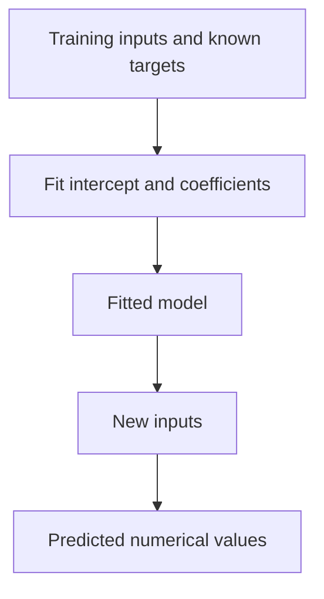

## 1. The problem: predicting a numerical value
Suppose we want to estimate a house's price from its area.

| Area in square feet | Price in ₹ lakh |
|---:|---:|
| 600 | 30 |
| 900 | 42 |
| 1,200 | 54 |
| 1,500 | 66 |

In this simplified example, larger houses have higher prices. We would like a rule that uses this pattern to estimate the price of another house.
- **Feature, $x$:** House area.
- **Target, $y$:** Observed house price.
- **Prediction, $\hat{y}$:** Estimated house price.
- **Sample:** One house with its measurements.

==Linear regression is a supervised learning method that predicts a numerical target using a weighted combination of features and an intercept.==
It is called *regression* because the output is a numerical quantity, such as price, rent, energy use, or delivery duration.

## 2. Simple linear regression: fitting one line
### The prediction equation
With one feature, the model is:
$$
\boxed{\hat{y} = b_0 + b_1x}
$$

| Symbol    | Meaning             | House-price interpretation                               |
| --------- | ------------------- | -------------------------------------------------------- |
| $x$       | Input feature       | Area in square feet                                      |
| $\hat{y}$ | Predicted target    | Predicted price in ₹ lakh                                |
| $b_0$     | Intercept           | Predicted price when area is zero                        |
| $b_1$     | Slope / coefficient | Change in predicted price for one additional square foot |
The intercept and slope are **learned parameters**. Fitting chooses their values from training data.

### A numerical example
Suppose the learned rule is:
$$
\widehat{\text{price}} = 6 + 0.04\times\text{area}
$$
For a house of 1,000 square feet:
$$
\widehat{\text{price}} = 6 + 0.04(1000) = 46\text{ lakh}
$$

**Interpret the slope:** An additional square foot is associated with an increase of ₹0.04 lakh, or ₹4,000, in the model's predicted price. An additional 100 square feet increases the prediction by ₹4 lakh.

**Interpret the intercept carefully:** The model predicts ₹6 lakh at zero square feet, but a zero-area house is outside the useful setting. The intercept positions the line; it does not always have a meaningful real-world interpretation.

### What changing the parameters does

| Change                    | Effect on the line                               |
| ------------------------- | ------------------------------------------------ |
| Increase $b_0$            | Move the line upward without changing its slope  |
| Increase a positive $b_1$ | Make the upward slope steeper                    |
| Set $b_1=0$               | Predict the same value for every input           |
| Use a negative $b_1$      | Make predictions decrease as the input increases |

### Why points do not lie exactly on the line
Real house prices also depend on location, age, condition, and many other influences. Measurements may contain noise. Two houses with the same area need not have the same price.

A conceptual description of the observed data is:
$$
\boxed{y = \beta_0 + \beta_1x + \varepsilon}
$$
Here, _$\varepsilon$ represents variation not captured by the linear relationship_. We use $b_0$ and $b_1$ for the fitted estimates of the unknown population coefficients $\beta_0$ and $\beta_1$.

> [!note] Prediction is an estimate
> The fitted line represents an estimated average relationship, not a promise that every house will have exactly the predicted price.

## 3. How does the model learn the line?
### Step 1: Make predictions
For a candidate intercept and slope, calculate a predicted value for every training sample.

### Step 2: Measure residuals
A **residual** is the observed value minus the predicted value:
$$
\boxed{e_i = y_i - \hat{y}_i}
$$

| Actual price | Predicted price | Residual | Interpretation                       |
| -----------: | --------------: | -------: | ------------------------------------ |
|           50 |              46 |     $+4$ | The model underpredicted by ₹4 lakh. |
|           42 |              46 |     $-4$ | The model overpredicted by ₹4 lakh.  |

Geometrically, ==the residual is the **vertical distance** between a point and the fitted line==.

Why not average signed residuals as the loss? Positive and negative values cancel. In the table, their average is zero despite both predictions being wrong.

### Step 3: Summarize the errors with a loss
A **loss function** measures how poorly the predictions fit the observed targets.

The **mean squared error**, or MSE, is:
$$
\boxed{\operatorname{MSE} = \frac{1}{n}\sum_{i=1}^{n}(y_i-\hat{y}_i)^2}
$$
Read this as: **subtract, square, and average**.
- Squaring prevents positive and negative residuals from canceling.
- Large mistakes receive more weight: residuals of 2 and 10 contribute 4 and 100.
- Lower MSE means predictions are closer to the observed targets on that dataset.

### Step 4: Choose parameters that minimize the loss
**Ordinary least squares (OLS)** chooses coefficients that minimize the sum of squared training residuals:
$$
\boxed{\min_{b_0,b_1}\sum_{i=1}^{n}\left[y_i-(b_0+b_1x_i)\right]^2}
$$
Minimizing this sum also minimizes training MSE because $n$ is fixed.
The “best line” here means **best according to squared training error**. It does not automatically mean best on future observations.



### Optional reference: the one-feature solution
When the input feature has nonzero variation, the fitted coefficients satisfy:
$$
\boxed{b_1 = \frac{\sum_i(x_i-\bar{x})(y_i-\bar{y})}{\sum_i(x_i-\bar{x})^2},
\qquad b_0 = \bar{y} - b_1\bar{x}}
$$
No derivation is needed for this lesson. The intuition is that the slope reflects how $x$ and $y$ vary together relative to how much $x$ varies. With an intercept, the fitted line passes through the training-data point $(\bar{x},\bar{y})$.

## 4. A practical approach
Before writing code, make the modeling choices explicit.

| Step | Question to ask |
|---|---|
| Define the target | What numerical value will we predict, and in what units? |
| Choose features | Will these inputs be available when a prediction is needed? |
| Inspect training data | Are values plausible? Is the relationship roughly linear? |
| Separate evaluation data | Does the split represent the future use case? |
| Fit the model | What intercept and coefficients are learned? |
| Evaluate | Does it beat a simple baseline on unseen examples? |
| Diagnose limitations | Are there residual patterns, unusual observations, or unsafe extrapolations? |

> [!tip] Avoid leakage
> Never put the target or information derived from the final outcome into the features. If preprocessing learns values from data, fit it using the training portion only.

## 5. Python demonstration: house prices
### About the dataset
We will use a small synthetic dataset with:
- `area_sqft`: house area;
- `age_years`: house age;
- `price_lakh`: price in ₹ lakh.

We begin by using **area alone**. Later, we add age to introduce multiple linear regression without changing datasets.

The generator creates a controlled example with a known relationship. These coefficients are invented for teaching and should not be interpreted as real housing-market estimates.

### Cell 1 — Create the data
```python
import numpy as np
import pandas as pd
import matplotlib.pyplot as plt
from sklearn.model_selection import train_test_split
from sklearn.linear_model import LinearRegression
from sklearn.dummy import DummyRegressor
from sklearn.metrics import mean_absolute_error, mean_squared_error, r2_score

rng = np.random.default_rng(42)
area = rng.uniform(500, 2000, 120)
age = rng.uniform(0, 30, 120)
price = 12 + 0.045 * area - 0.4 * age + rng.normal(0, 3, 120)

df = pd.DataFrame({
    "area_sqft": area,
    "age_years": age,
    "price_lakh": price
})
print(df.head().round(2))
```

**Explain the important lines:**
- The random generator's seed makes the example repeatable.
- `120` creates 120 house observations.
- The target increases with area and decreases with age, with random noise added.
- We know the generating rule because this is synthetic data. During normal model development, we only observe the recorded inputs and targets.

### Cell 2 — Split and inspect
```python
train_df, test_df = train_test_split(
    df, test_size=0.20, random_state=42
)
X_train = train_df[["area_sqft"]]
y_train = train_df["price_lakh"]
X_test = test_df[["area_sqft"]]
y_test = test_df["price_lakh"]

print("Training samples:", len(train_df))
print("Test samples:", len(test_df))
plt.scatter(X_train["area_sqft"], y_train, alpha=0.7)
plt.xlabel("Area (square feet)")
plt.ylabel("Price (₹ lakh)")
plt.title("Training data: is a straight line plausible?")
plt.show()
```

**Interpretation:**
- There are **96 training samples and 24 test samples**.
- Double brackets, `[["area_sqft"]]`, produce a two-dimensional feature table with shape `(96, 1)`.
- The plot should show an upward trend with scatter. A straight line is a plausible first approximation.
- Keeping entire rows together during splitting also lets us reuse exactly the same houses when adding age later.

A random split is appropriate for these independent synthetic observations. Time-ordered or grouped real data may require a different split.

### Cell 3 — Fit and interpret the parameters
```python
model = LinearRegression()
model.fit(X_train, y_train)

print(f"Intercept: {model.intercept_:.3f}")
print(f"Area coefficient: {model.coef_[0]:.5f}")

new_house = pd.DataFrame({"area_sqft": [1200]})
predicted_price = model.predict(new_house)[0]
print(f"Prediction for 1200 sq ft: ₹{predicted_price:.2f} lakh")
```

**Explain:**
- `LinearRegression()` creates an unfitted model.
- `.fit(...)` learns its intercept and coefficient using training data.
- `.intercept_` and `.coef_` expose learned values. The trailing underscore convention indicates fitted attributes.
- `.predict(...)` applies the fitted model; it does not retrain it.
- A positive area coefficient means larger area produces a higher prediction under this fitted rule.
- The coefficient has units **₹ lakh per square foot**. Multiply it by 100 to describe a 100-square-foot difference.

**Expected output, approximately:** intercept **5.502**, area coefficient **0.04541**, and a prediction of **₹60.00 lakh** for 1,200 square feet.

The fitted area-only coefficients need not equal the generating rule's coefficients: the model omits age, and the sample contains noise.

### Cell 4 — Plot the learned line
```python
area_grid = pd.DataFrame({"area_sqft": np.linspace(500, 2000, 100)})
plt.scatter(X_train["area_sqft"], y_train, alpha=0.65, label="Training houses")
plt.plot(area_grid["area_sqft"], model.predict(area_grid),
         color="red", label="Fitted line")
plt.xlabel("Area (square feet)")
plt.ylabel("Price (₹ lakh)")
plt.title("Simple linear regression")
plt.legend()
plt.show()
```
`area_grid` supplies ordered plotting inputs. It is not additional training data. Most points will not sit exactly on the line because area does not explain every price difference.

## 6. Evaluating predictions
### Training performance versus test performance
- **Training error:** How closely the fitted model matches the data used to learn its parameters.
- **Test error:** How it performs on held-out observations.
- **Generalization:** Its ability to predict accurately for new, relevant observations.

_A low training error alone is insufficient. If training error is much lower than test error, investigate overfitting or differences between the datasets. If both errors are high, the model may be missing useful structure or features._

### → Mean absolute error: MAE
$$
\boxed{\operatorname{MAE} = \frac{1}{n}\sum_{i=1}^{n}|y_i-\hat{y}_i|}
$$
**Intuition:** The average absolute size of a prediction mistake.

If MAE is 4, predictions differ from observed prices by **₹4 lakh on average in absolute terms**. Individual errors can be much larger or smaller.

### → Root mean squared error: RMSE
$$
\boxed{\operatorname{RMSE} = \sqrt{\frac{1}{n}\sum_{i=1}^{n}(y_i-\hat{y}_i)^2}}
$$
**Intuition:** A measure of error that gives more weight to large mistakes, expressed in the original target units.

If targets are in ₹ lakh, RMSE is also in ₹ lakh. MSE instead has squared units. On the same residuals, RMSE is at least as large as MAE.

### → R-squared: $R^2$
For targets with nonzero variation:
$$
\boxed{R^2 = 1 - \frac{\sum_i(y_i-\hat{y}_i)^2}{\sum_i(y_i-\bar{y})^2}}
$$

Here, $\bar{y}$ is the mean target value **in the dataset being scored**.
**Intuition:** Compare squared prediction errors against the target variation around that dataset's mean.

| Value   | Meaning                                                        |
| ------- | -------------------------------------------------------------- |
| $R^2=1$ | Perfect predictions on the evaluated data                      |
| $R^2=0$ | Same squared error as predicting that evaluated dataset's mean |
| $R^2<0$ | Worse squared error than that mean reference                   |
An $R^2$ of 0.8 is often described as accounting for 80% of target variation relative to the mean reference. It does **not** mean “80% accurate,” and it does not imply causation.

> [!note] A real predictive baseline
> On held-out data, our practical baseline predicts the **training mean**, since the test targets would not be known at prediction time. This differs from the test mean used internally in the test-set $R^2$ formula, so the baseline's test $R^2$ need not be exactly zero.

### Compare the metrics

| Metric | Better direction | Units | Useful interpretation |
|---|---|---|---|
| MAE | Lower | Target units | Average absolute mistake |
| RMSE | Lower | Target units | Error measure that emphasizes large mistakes |
| $R^2$ | Higher | No units | Squared-error performance relative to the scored-set mean |

No universal threshold defines a “good” score. Judge errors using the application, target scale, baseline, and data quality. An error of ₹5 lakh could be acceptable for one setting and unacceptable for another.

### Cell 5 — Compare with a mean-prediction baseline
```python
baseline = DummyRegressor(strategy="mean")
baseline.fit(X_train, y_train)

for name, estimator in [("Linear regression", model), ("Mean baseline", baseline)]:
    train_pred = estimator.predict(X_train)
    test_pred = estimator.predict(X_test)
    print(f"\n{name}")
    print(f"Train RMSE: {np.sqrt(mean_squared_error(y_train, train_pred)):.2f}")
    print(f"Test MAE:   {mean_absolute_error(y_test, test_pred):.2f}")
    print(f"Test RMSE:  {np.sqrt(mean_squared_error(y_test, test_pred)):.2f}")
    print(f"Test R²:    {r2_score(y_test, test_pred):.3f}")
```

**Read the output:**
- The baseline ignores area and predicts the training mean for every house.
- The linear model should have substantially smaller test errors than the baseline on this dataset.
- Compare training and test RMSE, but remember that 24 test samples give only a limited estimate of future performance. Test error can occasionally be lower than training error because the samples differ.
- The useful conclusion is that area carries predictive information in this constructed dataset, not that the model is ready for real property valuation.

**Expected test results, approximately:**

| Model | MAE (₹ lakh) | RMSE (₹ lakh) | $R^2$ |
|---|---:|---:|---:|
| Linear regression | 4.09 | 5.28 | 0.922 |
| Training-mean baseline | 16.88 | 19.58 | −0.079 |

The linear model's training RMSE is about **4.34**. Numerical results may differ slightly across environments.

## 7. Multiple linear regression
### Add more than one feature
Area alone leaves out relevant information. Suppose we also know house age.
The model becomes:
$$
\boxed{\hat{y} = b_0 + b_1x_1 + b_2x_2}
$$
For $p$ features:
$$
\boxed{\hat{y} = b_0 + \sum_{j=1}^{p} b_jx_j}
$$
It is still **one numerical target**, predicted using multiple input features.

### Interpret each coefficient conditionally
Suppose the fitted equation is approximately:
$$
\widehat{\text{price}} = 12 + 0.045\times\text{area} - 0.4\times\text{age}
$$
- **Area coefficient:** Holding age fixed, 100 additional square feet increase the predicted price by ₹4.5 lakh.
- **Age coefficient:** Holding area fixed, one additional year decreases the predicted price by ₹0.4 lakh.

“Holding other features fixed” describes a comparison made by the model. It is not automatically an experimentally established causal effect.

### Cell 6 — Fit with area and age
```python
features = ["area_sqft", "age_years"]
multi_model = LinearRegression()
multi_model.fit(train_df[features], y_train)

print("Intercept:", round(multi_model.intercept_, 3))
print(pd.Series(multi_model.coef_, index=features).round(4))

houses = pd.DataFrame({
    "area_sqft": [1200, 1200],
    "age_years": [5, 25]
})
print("Predicted prices:", multi_model.predict(houses).round(2))
```

**Expected output, approximately:** an area coefficient of **0.0457**, an age coefficient of **−0.3437**, and predicted prices of **₹63.29 lakh** and **₹56.42 lakh**.

The two houses have identical area but different ages. The older house should have a lower predicted price. This makes the meaning of “holding area fixed” concrete.

This extension uses the original training rows. It introduces coefficient interpretation; we do not select a model by repeatedly checking the final test set.

### Important interpretation cautions
1. Coefficient magnitudes depend on feature units. A coefficient for square feet cannot be compared directly with one for years to rank importance.
2. Strongly related predictors, such as area in square feet and the same area in square meters, can make individual coefficients unstable or nonunique. This is called **multicollinearity**.
3. Adding a feature does not guarantee better test performance. More features can add useful information, irrelevant variation, or leakage.
4. Ordinary unregularized linear regression generally does not require standardizing features to define the fit. Scaling can help numerical behavior; coefficient-based regularization makes scale especially important.

## 8. Assumptions and model diagnostics
Linear regression can always be asked to fit a line to numerical data. The important question is whether that line provides a useful description or prediction rule.

### Main assumptions to understand

| Idea | Beginner-friendly meaning | What might go wrong? |
|---|---|---|
| Approximately linear, additive mean relationship | The average target is reasonably represented by the chosen linear combination of features | A straight line misses a strong curve or an interaction |
| No systematic unexplained component given the features | Errors should not consistently shift upward or downward for particular inputs | An omitted relevant factor can distort coefficient interpretation |
| Independent errors for standard statistical analysis | Unexplained deviations should not be linked across observations | Repeated houses or neighboring time points may have related errors |
| Roughly constant error variance for standard OLS uncertainty formulas | Error spread is similar across prediction levels | Expensive houses may have much larger error spread |
| No exact redundancy between predictors | One feature should not be an exact linear combination of others | Individual coefficients may not be uniquely identifiable |

“Approximately linear” refers to the expected target relationship, not a requirement that every observation lie on a line.

> [!note] Fitting, prediction, and inference are different questions
> Constant error variance and normally distributed errors are not requirements for running `.fit()` or producing a prediction. They matter for particular statistical guarantees and uncertainty calculations. Normal errors are commonly assumed for exact small-sample tests and intervals; neither features nor targets must themselves be normally distributed. Formal inference is outside this lesson.

### Use a residual plot
A residual plot asks whether the fitted model leaves visible structure behind.
- Horizontal axis: fitted values.
- Vertical axis: observed values minus fitted values.
- Reference line: zero residual.

| Appearance | Possible interpretation |
|---|---|
| Scatter around zero with no obvious structure | Consistent with a reasonable mean relationship; not proof of correctness |
| U-shaped or curved pattern | The model may be missing nonlinear structure |
| Funnel-shaped spread | Error variability may depend on prediction level |
| Isolated large residuals | Unusual observations, missing factors, or data-quality issues |

### Cell 7 — Inspect training residuals
```python
fitted = model.predict(X_train)
residuals = y_train.to_numpy() - fitted

plt.scatter(fitted, residuals, alpha=0.7)
plt.axhline(0, color="red", linestyle="--")
plt.xlabel("Fitted price (₹ lakh)")
plt.ylabel("Residual: actual − fitted (₹ lakh)")
plt.title("Training residuals: look for remaining patterns")
plt.show()
```

This diagnostic uses training data, where we can investigate model behavior without consuming an independent test set. It does not measure generalization. A structure-free plot also cannot rule out every missing feature or dependency.

For OLS with an intercept, training residuals sum to approximately zero by construction. A zero average residual alone is therefore not evidence that the model is good.

## 9. Limitations and common pitfalls
### Outliers and influential observations
Squared loss gives large residuals substantial weight. An unusual observation can pull the fitted line toward itself. A point far from the other inputs can also have high influence.

**Approach:** Investigate the observation. It may be a recording error, a valid rare case, or evidence of a missing feature. Do not delete it simply to improve a score.

### Interpolation versus extrapolation
- **Interpolation:** Predict within the observed input range or region.
- **Extrapolation:** Predict outside that region.

Our example includes areas from roughly 500 to 2,000 square feet. A prediction for 1,200 square feet is within that range; one for 10,000 square feet is extrapolation. A fitted line can produce a number there even when its relationship is no longer credible.

With multiple features, an unfamiliar *combination* can also be risky, even if each individual value is within its observed range.

### Correlation does not establish causation
An association between area and price does not prove that increasing area alone causes the predicted price difference. Location, construction quality, and other factors may influence both variables.

**Teaching phrase:** “The model predicts an association under its fitted rule; a causal claim needs additional evidence and assumptions.”

### A linear model can underfit or overfit
A line may underfit a strongly curved relationship. A model with many noisy or redundant features relative to the number of samples can overfit, even though it is called linear regression.

A more complex model is not automatically the right response to poor performance. First inspect the data, features, evaluation design, and residuals.

### What does “linear” mean?
The model is linear in its **coefficients**. For example:
$$
\hat{y}=b_0+b_1x+b_2x^2
$$
is a curved function of $x$ but remains linear in the learned coefficients. We can fit it using linear regression on the features $x$ and $x^2$.

## 10. Classroom questions
### Question 1 — Interpret the slope
A model is $\hat{y}=10+0.05x$, where $x$ is square feet and $y$ is price in ₹ lakh. How much does the prediction change for 200 additional square feet?
**Answer:** $0.05\times200=10$ lakh. This is a model prediction difference, not automatically a causal effect.

### Question 2 — Read the residual
A house sells for ₹60 lakh; the model predicts ₹54 lakh. What is its residual?
**Answer:** $60-54=+6$ lakh. The model underpredicted.

### Question 3 — Challenge the score
A model has an $R^2$ of 0.9. Does it predict every house within 10% of its price?
**Answer:** No. $R^2$ summarizes squared-error performance relative to variation around the evaluated targets' mean. It is not a percentage-error guarantee.

### Question 4 — Think about features
Would adding the final sale-registration amount help predict the sale price before a sale occurs?
**Answer:** It would leak the outcome. A useful feature must be available at prediction time.

### Question 5 — Compare models responsibly
If adding 20 features reduces training error, have we established that the model is better?
**Answer:** No. Check validation or cross-validation performance and whether the features are legitimate and stable. Reserve the final test for the completed development process.

## 11. Revision summary

| Concept | Remember |
|---|---|
| Linear regression | Predicts a numerical value with an intercept and weighted features |
| Slope | Predicted change per unit of input; conditional on other features in a multiple-feature model |
| Intercept | Prediction when all model inputs are zero; may lack practical meaning |
| Residual | Actual minus predicted value |
| Ordinary least squares | Minimizes squared training residuals |
| MAE | Average absolute error in target units |
| RMSE | Error measure in target units that emphasizes large mistakes |
| $R^2$ | Squared-error performance relative to the scored-set mean |
| Baseline | A simple reference such as predicting the training mean |
| Generalization | Performance on new, relevant observations |
| Residual plot | A diagnostic for structure remaining after fitting |
| Main cautions | Leakage, omitted factors, outliers, extrapolation, and causal overinterpretation |
	