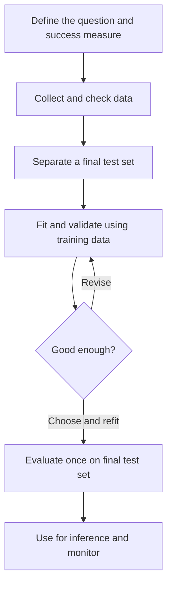

## 1. Why machine learning?
### What is ML?
**Machine learning (ML) is a way to build systems that learn patterns from data to make predictions or discover structure.**

In ordinary rule-based programming, a person writes the decision rules. In ML, a learning algorithm uses examples to fit a model.

| Approach | Spam-filter example |
|---|---|
| Explicit rules | “If the subject contains this phrase, mark the email as spam.” |
| ML | Learn patterns from emails already marked spam or not spam; use them on new emails. |

### Why is it useful?
ML helps when useful patterns exist but writing and maintaining every rule is difficult. Examples can capture variation that a short rule list misses.

| Relatable problem | Information available | Useful output |
|---|---|---|
| Estimate a used bicycle's price | Age, condition, brand | Predicted price |
| Sort incoming emails | Words and other email properties | Spam or not spam |
| Understand shopping behavior | Customers' purchase patterns | Groups with similar behavior |
| Estimate building energy use | Outdoor temperature and other conditions | Predicted energy use |

**ML is not always necessary:** calculating an invoice total needs a clear formula. A fixed temperature threshold may be enough for a simple alarm. Start with the problem and a simple baseline.

## 2. Vocabulary and workflow — 10 minutes
### One small table, many important terms
Suppose each row describes one used bicycle:

| Bicycle | Age in years | Condition score | Price in ₹ |
|---|---:|---:|---:|
| A | 1 | 9 | 8,000 |
| B | 4 | 6 | 3,500 |
| C | 2 | 8 | 6,000 |

| Term | What it means | Why it matters / example |
|---|---|---|
| **Sample / observation** | One example, usually one row | Bicycle A is one sample. We need examples representative of future cases. |
| **Feature** | An input used by the model | Age and condition; inputs must be available when predicting. |
| **Target** | The quantity or category we want to predict | Price; it defines the supervised task. |
| **Label** | The known target value for a sample | ₹8,000 is A's label. Labels can be numbers or categories. |
| **Model** | A fitted rule that maps inputs to outputs | A rule relating bicycle age and condition to price. |
| **Training / fitting** | Using training examples to learn model parameters | Adjust the rule so predicted prices match known prices reasonably well. |
| **Inference / prediction** | Applying the fitted model to inputs | Predict the price of another bicycle. Its actual price is not required. |
| **Evaluation** | Measuring how well predictions match known targets | Compare predicted and actual prices on held-out examples. |
| **Generalization** | Performing well on new, relevant examples | Useful pricing for new bicycles, beyond those used for training. |
| **Data leakage** | Using information during model development that would not legitimately be available | Including the final sale price as an input, or learning preprocessing from the test set. |

In Python, **`X` usually holds features** and **`y` holds targets**. With 100 bicycles and 2 features, `X.shape` is `(100, 2)` and `y.shape` is `(100,)`.

### From a question to a useful prediction


- **Before fitting:** Check missing values, duplicates, and whether features will be available at prediction time.
- **During development:** Compare model choices using validation data or cross-validation.
- **After selection:** Evaluate the chosen model on the final test set.
- **During use:** Monitor performance because future data can change.

> [!note] Training versus inference
> `model.fit(X_train, y_train)` learns from examples. `model.predict(X_new)` uses what was learned. Ordinary prediction does not retrain the model.

### Leakage: accidentally giving away the answers
**Why it matters:** Leakage makes evaluation look better than real use.

Three common routes:
1. **Answer-like feature:** Predict tomorrow's energy use using tomorrow's recorded energy bill.
2. **Preprocessing leakage:** Compute scaling values using all data before splitting. The test set has influenced model development.
3. **Overlap:** Put duplicate records of the same event in both training and testing.

**Prevention:** Split first. Fit learned preprocessing only on the training portion, including inside every cross-validation fold. Keep answer-like features out.

## 3. Types of ML and prediction tasks
### Supervised learning: learn from inputs and known answers
**What:** Training examples include features `X` and targets `y`.
**Why:** We want to predict the target for new examples.

| Task               | Output               | Example                           | Simple evaluation idea                       |
| ------------------ | -------------------- | --------------------------------- | -------------------------------------------- |
| **Regression**     | A numerical quantity | Bicycle price or daily energy use | How far are predictions from actual values?  |
| **Classification** | A category           | Spam/not spam; bicycle type       | How often is the predicted category correct? |

**Quick distinction:** “How much energy?” is regression. “High or low energy use?” is classification if those categories are defined in advance.

A classifier may output a probability, such as a 0.8 probability of spam, before assigning a category. That does not turn it into a regression task.

### Unsupervised learning: look for structure without target labels
**What:** Training data contains features, but no supplied target answers for the task.
**Why:** We may want to explore similarities or represent many measurements more compactly.

| Task | What it does | Relatable example | Important limitation |
|---|---|---|---|
| **Clustering** | Groups similar samples | Group shoppers using purchase patterns | Groups are not automatically meaningful categories. |
| **Dimensionality reduction** | Represents samples using fewer features | Summarize 20 shopping measurements using 2 combined measurements for a plot | Some information may be lost. |

**Clustering versus classification:** Classification learns predefined categories from labeled examples. Clustering discovers groups without those category labels.

**Dimensionality reduction versus clustering:** Reduction changes the representation of each sample; clustering assigns samples to groups. Reduction is not necessarily selecting a few original columns: PCA, for example, creates combinations of features.

> [!note] Scope
> These are two major learning settings, not an exhaustive list. Today's coding examples use supervised regression so we can focus on one consistent workflow.

Ask the class to name the task:
1. Predict monthly rent. → **Regression**
2. Predict whether an email is spam. → **Classification**
3. Discover groups of similar songs without genre labels. → **Clustering**
4. Compress 50 song measurements into 2 coordinates for a plot. → **Dimensionality reduction**

## 4. Train–test split
### What, why, and intuition
**What:** Divide data into a training portion and a held-out test portion.
**Why:** Performance on examples used for fitting can be misleading. The test set estimates performance on unseen data from the relevant population.

**Analogy:** Practice questions help you learn; an unseen exam checks what you can apply. Repeatedly using the exam answers to revise makes it a practice set.

| Portion | Purpose | Used to learn fitted parameters? |
|---|---|---|
| Training | Fit the model | Yes |
| Validation | Compare choices during development | No, in that validation run |
| Final test | Evaluate the chosen model after development | No |

Common **training:test** ratios are **80:20**, **75:25**, and **70:30**. There is no universally best ratio: both portions need enough representative examples. With abundant data, a smaller test percentage may still give a useful estimate.

We will set aside 20% as the final test set. Cross-validation will use only the remaining 80% for model selection.

### Shared coding example
We create **90 synthetic observations** of outdoor temperature and building energy use. Energy use is higher in cold weather and hot weather because of heating and cooling.
- **Feature:** Outdoor temperature in °C.
- **Target:** Daily energy use in arbitrary units.
- **Task:** Regression.
- **Purpose:** A clear, controlled learning example, not a real building-energy model.


### Cell 1 — Create data, split, and define candidate models
```python
import numpy as np
import matplotlib.pyplot as plt
from sklearn.model_selection import train_test_split, KFold, cross_val_score
from sklearn.pipeline import make_pipeline
from sklearn.preprocessing import StandardScaler, PolynomialFeatures
from sklearn.linear_model import LinearRegression
from sklearn.metrics import mean_squared_error

rng = np.random.default_rng(42)
X = rng.uniform(5, 35, size=(90, 1))
y = 2 + 0.02 * (X[:, 0] - 20)**2 + rng.normal(0, 0.35, size=90)

X_train, X_test, y_train, y_test = train_test_split(
    X, y, test_size=0.20, random_state=42
)
print("Training:", X_train.shape, "Test:", X_test.shape)

def make_model(degree):
    return make_pipeline(
        StandardScaler(),
        PolynomialFeatures(degree=degree, include_bias=False),
        LinearRegression()
    )

plt.scatter(X_train[:, 0], y_train, alpha=0.75)
plt.xlabel("Outdoor temperature (°C)")
plt.ylabel("Daily energy use (arbitrary units)")
plt.title("Training data: look for the overall pattern")
plt.show()
```

**Important lines and output:**
- `size=(90, 1)` creates 90 rows with one feature. scikit-learn expects a two-dimensional feature array.
- The expression for `y` creates a U-shaped relationship; random noise represents other influences and measurement variation. A real dataset would supply observed targets.
- `train_test_split` splits `X` and `y` together, keeping each input paired with its target.
- `test_size=0.20` reserves **18 samples**; **72** remain for training. The printed shapes are `(72, 1)` and `(18, 1)`.
- `random_state=42` makes the split repeatable. It does not make a split inherently better.
- `StandardScaler` learns a mean and scale. The pipeline ensures these are learned only from the portion being fitted.
- `PolynomialFeatures` supplies powers of the scaled input. Degree 1 can fit a line; degree 2 can fit a U-shaped curve; degree 15 permits much more flexibility.
- `include_bias=False` avoids adding a constant feature because `LinearRegression` already fits an intercept.

The function defines a model recipe; it does not fit a model yet. The plot should suggest that a straight line may miss the pattern.

> [!note] Choose the split to match real use
> Random splitting suits this independent synthetic dataset. For future predictions from time-ordered data, train on earlier observations and evaluate on later ones. If many rows belong to the same person or building, keep groups separate when evaluating performance on new groups. For classification, `stratify=y` can help preserve class proportions when class counts permit.

## 5. Cross-validation
### Why one validation split may not be enough
One split can be unusually easy or difficult. A model may appear better simply because of which examples landed in validation.

**Cross-validation (CV)** evaluates a model recipe across several training–validation divisions, giving a broader view of its performance within the available development data.

### K-fold intuition
1. Divide the training data into **K folds**, or chunks.
2. Hold out one fold as validation and fit on the other K−1 folds.
3. Repeat until every fold has served as validation once.
4. Compare the average validation error and how much it varies across folds.

For **5-fold CV**, each model fit uses about 80% of the development data and validates on the remaining 20%. Common choices are **K = 5** or **10**; larger K requires more fits and is not automatically better.

### Visual: rotate the held-out fold
**T = used for fitting; V = held out for validation in that round.** The separate final test set is absent from this table.

| CV round | Fold A | Fold B | Fold C | Fold D | Fold E |
|---|---|---|---|---|---|
| 1 | **V** | T | T | T | T |
| 2 | T | **V** | T | T | T |
| 3 | T | T | **V** | T | T |
| 4 | T | T | T | **V** | T |
| 5 | T | T | T | T | **V** |

Each sample is used for validation once and training four times. **Each round starts with a fresh model fit**; it does not continue training the previous round's model.

### Error measure: mean squared error
**Mean squared error (MSE)** averages the squared differences between predictions and actual values.
- **Lower is better**; zero means every evaluated prediction is exact.
- Squaring gives larger mistakes more weight.
- MSE is measured in squared target units; it is not a percentage or accuracy score.
- Compare MSE values on the same target scale and evaluation setup.

### Cell 2 — Compare three model complexities with CV
```python
cv = KFold(n_splits=5, shuffle=True, random_state=42)
degrees = [1, 2, 15]
cv_means = {}

for degree in degrees:
    scores = cross_val_score(
        make_model(degree), X_train, y_train,
        cv=cv, scoring="neg_mean_squared_error"
    )
    fold_mse = -scores
    cv_means[degree] = fold_mse.mean()
    print(f"Degree {degree:2}: fold MSE = {fold_mse.round(3)}")
    print(f"           mean = {fold_mse.mean():.3f}, "
          f"std = {fold_mse.std():.3f}")

best_degree = min(cv_means, key=cv_means.get)
print("Selected degree:", best_degree)
```

**Important lines and interpretation:**
- `shuffle=True` mixes observations before forming folds; the seed makes this repeatable.
- All candidates use the same folds for a fairer comparison.
- `cross_val_score` fits fresh copies of the complete pipeline. Scaling is learned inside each training fold, preventing preprocessing leakage.
- scikit-learn uses a “higher is better” scoring convention. `neg_mean_squared_error` returns negative MSE, so `-scores` restores ordinary positive errors.
- `std` describes variation across these fold scores. It is **not** a confidence interval or a guaranteed future error range.
- `min(...)` selects the candidate with the lowest average validation MSE.

**Expected result, approximately:**

| Degree | Mean CV MSE | What it suggests |
|---|---:|---|
| 1 | 1.915 | A line misses the curved relationship. |
| 2 | 0.133 | A simple curve captures the pattern well. |
| 15 | 0.525 | Extra flexibility is less reliable across folds. |

Degree 2 should be selected. Minor numeric differences may occur across environments. No `X_test` or `y_test` was used here.

> [!note] CV does not replace the final test
> We used CV results to choose a degree, so those results participated in development. The final test set provides a separate check after that choice. Shuffled K-fold also needs alternatives for time-ordered or grouped data, just as random train–test splitting does.

## 6. Underfitting and overfitting
### What are we trying to learn?
Useful data contains both **patterns** and **noise**. A good model captures a useful pattern without chasing every accidental fluctuation.

| Behavior | Intuition | Training error | Unseen-data error | Typical response |
|---|---|---|---|---|
| **Underfitting** | Too simple to capture useful structure | High | High | Improve features or allow more complexity |
| **Reasonable fit** | Captures useful structure | Relatively low | Relatively low and comparable | Verify on relevant held-out data |
| **Overfitting** | Fits details that do not carry over | Very low, relative to alternatives | Higher than training; may worsen as complexity rises | Reduce complexity, regularize, or obtain more representative data |

**Relatable example:** Memorizing solutions to practice questions can produce excellent practice scores but poor performance when the wording changes. Learning the underlying method transfers better.

**Model complexity** means flexibility: the range of patterns a model can represent. A higher polynomial degree permits more bends. More flexibility can help capture a curve, but also lets a model follow noise.

> [!note] Read errors carefully
> A small training–validation gap alone does not prove a good model: both errors might be high. A gap alone does not prove overfitting either: a small or unrepresentative validation set can affect it. Compare error levels, competing models, plots, and CV results.

### Cell 3 — See the fits and compare errors
For this illustration, make a temporary validation split **inside the training set**. Validation plays the unseen-data role in the comparison; the final test set remains untouched.
```python
X_fit, X_val, y_fit, y_val = train_test_split(
    X_train, y_train, test_size=0.25, random_state=42
)
grid = np.linspace(5, 35, 400).reshape(-1, 1)
train_errors, val_errors = [], []
fig, axes = plt.subplots(1, 3, figsize=(13, 3.6), sharey=True)

for ax, degree in zip(axes, degrees):
    model = make_model(degree)
    model.fit(X_fit, y_fit)
    train_mse = mean_squared_error(y_fit, model.predict(X_fit))
    val_mse = mean_squared_error(y_val, model.predict(X_val))
    train_errors.append(train_mse)
    val_errors.append(val_mse)

    ax.scatter(X_fit[:, 0], y_fit, s=22, label="Training")
    ax.scatter(X_val[:, 0], y_val, s=30, marker="x", label="Validation")
    ax.plot(grid[:, 0], model.predict(grid), color="black", label="Model")
    ax.set_title(f"Degree {degree}\nTrain {train_mse:.3f} | Val {val_mse:.3f}")
    ax.set_xlabel("Temperature (°C)")
    ax.set_ylim(0, 8)
    print(f"Degree {degree}: train MSE={train_mse:.3f}, "
          f"validation MSE={val_mse:.3f}")

axes[0].set_ylabel("Energy use")
axes[0].legend(fontsize=8)
plt.tight_layout()
plt.show()

positions = np.arange(len(degrees))
plt.figure(figsize=(6, 3.5))
plt.plot(positions, train_errors, "o-", label="Training MSE")
plt.plot(positions, val_errors, "o-", label="Validation MSE")
plt.xticks(positions, degrees)
plt.xlabel("Polynomial degree (increasing flexibility)")
plt.ylabel("Mean squared error — lower is better")
plt.title("Does more flexibility help on unseen examples?")
plt.legend()
plt.tight_layout()
plt.show()
```

**Important lines and interpretation:**
- The temporary split uses **54 fitting samples and 18 validation samples**. These validation samples come from the 72 training samples, not the final test set.
- `fit` sees only `X_fit, y_fit`. Both sets can then be passed to `predict` to compare errors.
- `grid` makes a smooth line for visualization; it is not extra training data.
- The first figure shows the learned shape. The second compares training and validation errors across the three candidates; its horizontal positions are ordered categories, not equally spaced numeric degrees.
- `set_ylim(0, 8)` keeps the data region readable; a very flexible curve can extend beyond the displayed range. Printed MSE values still include every evaluated prediction.

**What to look for:**
- **Degree 1:** A straight line misses the U-shaped pattern. Training and validation errors are high: underfitting.
- **Degree 2:** A smooth curve follows the overall trend. Validation MSE is about **0.122**.
- **Degree 15:** Training error falls, but validation MSE rises to about **0.211**. Extra bends, especially near boundaries, illustrate overfitting.

The five-fold results provide stronger support than this single illustrative split. A flexible model will not necessarily perform worse on every possible split.

> [!tip] Pause before running
> Which model will probably have the lowest training error? Must it also have the lowest validation error?
>
> **Answer:** Degree 15 can fit the training data most closely, but extra flexibility can fit noise and hurt generalization.

## 7. Regularization
### What, why, and example
**Regularization** discourages overly complex fitted solutions. In common regression models, it adds a penalty for large learned coefficients to the training objective.

**Why it matters:** When several fits explain the training data well, a less extreme fit may be more stable on new examples.

**Intuition:** Instead of rewarding only closeness to practice answers, also discourage unnecessarily extreme rules. A little more training error may be acceptable if unseen-data error improves.

A useful verbal description is:
**Training objective = prediction error + strength × complexity penalty**

No derivation is needed. The fitted model balances the two terms.

| Method | Penalty intuition | Typical effect | scikit-learn example |
|---|---|---|---|
| **L1** | Penalize the sum of absolute coefficient sizes | Can set some coefficients exactly to zero, giving a sparse model | `Lasso(alpha=...)` |
| **L2** | Penalize the sum of squared coefficient sizes; large values cost especially heavily | Usually shrinks coefficients toward zero without making them exactly zero | `Ridge(alpha=...)` |

**Connection to our demo:** Degree 15 allows many coefficients. L2 regularization could discourage extreme coefficient values while retaining the polynomial feature set. Choosing a lower degree is another way to control complexity, but changes the available model shapes directly.
- **Too little regularization:** An overly flexible model may still chase noise.
- **Too much regularization:** The model may underfit.
- In `Ridge` and `Lasso`, a larger **`alpha`** means a stronger penalty. Choose it using validation or CV, not final test scores.
- Coefficient penalties depend on feature scale. Scale features appropriately inside the pipeline; for penalized polynomial regression, scale the generated polynomial columns too.

> [!note] Avoid two shortcuts
> Regularization encourages simpler fitted solutions; it does not guarantee better predictions. L1's zero coefficients do not automatically identify causal or uniquely important features.

## 8. Hyperparameters versus learned parameters
### Who chooses what?

| | Learned parameter | Hyperparameter |
|---|---|---|
| **What is it?** | A value learned during fitting | A setting chosen outside an individual fit |
| **Why does it matter?** | Determines the fitted prediction rule | Controls the model family, flexibility, or learning process |
| **Polynomial regression** | Coefficients and intercept | Polynomial degree |
| **Regularized regression** | Coefficients and intercept | Penalty type and strength, such as `alpha` |
| **Decision tree** | Which feature and threshold to split on | Maximum depth allowed |
| **How obtained?** | Training algorithm uses training data | Person or search procedure compares validation/CV results |

For a degree-2 model, fitting learns an intercept and two coefficients for the transformed input. **We choose the degree; fitting learns how strongly each term contributes.**

Although the scikit-learn API calls constructor settings “parameters,” in ML teaching these settings are commonly called **hyperparameters**, to distinguish them from learned coefficients.

### Tuning without contaminating evaluation
1. Propose a few hyperparameter choices: degrees 1, 2, and 15.
2. For each choice, fit fresh models within the CV folds.
3. Select using validation results: degree 2 here.
4. Refit that recipe on all 72 training samples.
5. Evaluate once on the 18 held-out test samples.

CV fits several temporary models. We still need to fit the selected recipe on all training data before using it.

### Cell 4 — Refit, evaluate, and make one new prediction
```python
final_model = make_model(best_degree)
final_model.fit(X_train, y_train)

test_predictions = final_model.predict(X_test)
test_mse = mean_squared_error(y_test, test_predictions)
print(f"Chosen degree: {best_degree}")
print(f"Final test MSE: {test_mse:.3f}")

new_temperature = np.array([[30.0]])
new_prediction = final_model.predict(new_temperature)
print(f"Predicted energy at 30°C: {new_prediction[0]:.2f} units")
```

**Interpretation:**
- `fit(X_train, y_train)` now uses all development data, including samples temporarily held out in earlier validation runs.
- The test MSE is a final estimate of error for this data setting, not a guarantee about every future building or temperature range.
- The last prediction is **inference**: a new feature value enters; an estimated target comes out. No new label or retraining is needed.
- Do not switch degrees after seeing this test score and continue calling the same test set an independent final evaluation.


## Revision: common misconceptions

| Misconception | Correction |
|---|---|
| “ML discovers the truth automatically.” | It learns patterns influenced by data, features, assumptions, and evaluation choices. Prediction does not establish causation. |
| “A label must be a category.” | Labels can be numerical targets in regression. |
| “Classification means only two classes.” | Classification may involve two or many predefined categories. |
| “Unsupervised learning has no useful output.” | It can reveal groups or create a compact representation, but interpreting usefulness needs care. |
| “A more complex model is always better.” | Training fit may improve while generalization worsens. |
| “Both errors are similar, so the model is good.” | Both may be high: underfitting. |
| “Cross-validation uses the final test set.” | Here it uses only training/development data. |
| “Scaling everything before splitting is harmless.” | Learned preprocessing must be fitted only on the relevant training portion. |
| “A random seed improves model quality.” | A seed improves reproducibility, not quality. |
| “Regularization removes all overfitting.” | It is one tool; data quality, representation, splitting, and tuning also matter. |

> [!tip] A habit for the next module
> Before trusting a score, ask: **What data did the model learn from, what data influenced our choices, and what data produced this score?**

